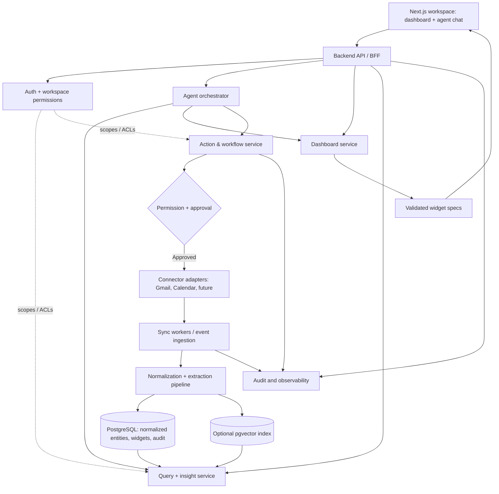
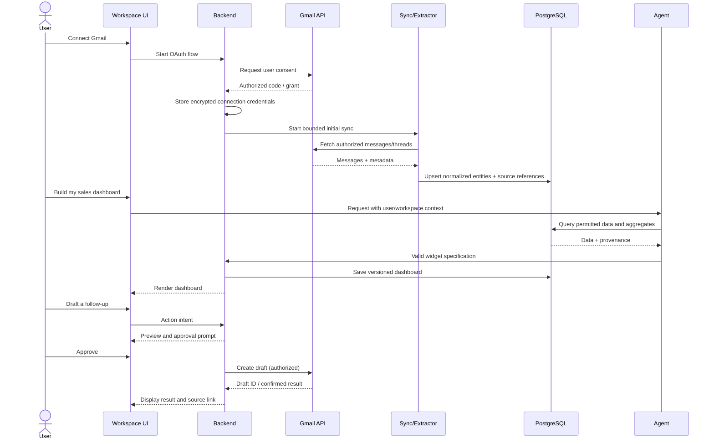

# AI Workspace OS — Product & Technical Blueprint

> **Working product name:** AI Workspace OS (placeholder)  
> **Project:** AlphaHack 2026 — Hackathon / Startup Concept  
> **Document type:** Product Requirements Document (PRD), Solution Architecture, Integration Roadmap, and MVP Execution Plan  
> **Status:** Proposed scope and design; not an implementation or evidence of completed features  
> **Last updated:** 2026-11-13

---

## 0. Executive Summary

**One-line pitch:** Connect your tools. Describe what matters. Get a personalized, continuously updated dashboard that understands your work and helps you act on it.

**Problem:** Important business information is scattered across Gmail, calendars, spreadsheets, CRMs, project managers, chat systems, payment tools, and documents. People manually hunt for updates, copy information into trackers, prepare dashboards, remember follow-ups, and coordinate work across disconnected interfaces.

**Solution:** An AI-powered *workspace infrastructure layer* that connects existing business applications, normalizes relevant information, generates customizable dashboards from natural-language instructions, and provides an agentic action layer for questions, follow-ups, and controlled automations.

**Core product loop:**

`Connect → Understand → Visualize → Ask → Act → Monitor`

**Initial wedge:** Gmail-first intelligence for founders, small-business operators, and sales teams. A user connects Gmail, asks for a business command center, sees leads/tasks/meetings/follow-ups, changes the dashboard conversationally, and approves a suggested Gmail draft. Google Calendar is the recommended second connector.

**Key product distinction:** The user does not have to manually model all data or configure every widget and workflow. The agent proposes an initial workspace based on the user's request, shows data provenance, and offers *approval-gated* actions.

**What this document covers:** users, jobs-to-be-done, feature inventory, dashboard widgets, integrations, workflows, agents, architecture, storage schema, APIs, security, metrics, product packaging, hackathon build scope, demonstration, roadmap, risks, and open decisions.

### 0.1 North-star experience

User: **“Connect my Gmail, show potential clients, unanswered proposals, upcoming meetings, and invoices that need attention.”**

The product:

1. Identifies which connected tools can provide the needed facts.
2. Asks for authorization or clarifies missing data sources if needed.
3. Searches and synchronizes permitted information.
4. Extracts business entities with source links and confidence/uncertainty labels.
5. Builds a dashboard with KPI cards, tables, action queues, timelines, and suggested automations.
6. Lets the user edit the workspace by saying “Only show prospects from the past 30 days.”
7. Suggests actions; explicitly requests approval before sending communications or mutating external systems.
8. Keeps data refreshed using scheduled sync, provider events, or both.

A dashboard must not silently infer that an email equals a confirmed sale, that an invoice is paid, or that a sender is a lead. These fields are classified as *inferred*, *confirmed*, or *unknown* with drill-down evidence.

---

## 1. Problem Definition and Opportunity

### 1.1 Existing workflow pain

- **Fragmented context:** an opportunity is discussed in Gmail, meetings appear in Calendar, deal values live in a spreadsheet, and tasks live in a project tool.
- **Manual dashboards:** people prepare recurring reports and copy data between applications.
- **Follow-up leakage:** unanswered proposals, deadlines, client requests, and approvals disappear in long email threads.
- **Tool switching:** users must open multiple applications to answer one operational question.
- **Difficult automation setup:** rule builders require familiarity with triggers, conditions, and provider terminology.
- **One-size-fits-all software:** a founder, recruiter, salesperson, and project manager need different information and different workflows.
- **Passive analytics:** many dashboards display information without allowing an immediate, controlled next action.

### 1.2 Jobs to be done

1. **Understand:** “Tell me what is happening across my connected workspace.”
2. **Prioritize:** “Show me what needs my attention today.”
3. **Organize:** “Create a workspace for my specific job.”
4. **Find:** “Show the original conversation or record behind this metric.”
5. **Act:** “Draft the right response, create a task, or schedule a follow-up.”
6. **Monitor:** “Alert me when something changes or stalls.”
7. **Share:** “Give my team a permitted, role-appropriate view.”
8. **Embed:** “Allow our own application to offer these capabilities.” (future platform offering)

### 1.3 Success definition

A user with an authorized Gmail test account can go from blank workspace to a personalized dashboard, drill into a source-backed insight, change a widget through chat, and create an approved Gmail draft—without manually coding queries or building a dashboard.

---

## 2. Target Users and Initial Market

| Persona | Main frustrations | Desired dashboard | Core integrations |
|---|---|---|---|
| **Founder / SMB owner** | Too many inbox requests and disconnected operating data | Priority inbox, customer follow-ups, meetings, outstanding items | Gmail, Calendar, Sheets, Stripe |
| **Sales manager / representative** | Prospects lost in email, proposals left unanswered | Leads, pipeline, unanswered proposals, next meetings | Gmail, Calendar, HubSpot, Salesforce |
| **Project manager / operations lead** | Status updates spread through email and collaboration tools | Deadlines, blockers, status, assigned tasks | Gmail, Slack, Linear, Jira, Notion |
| **Recruiter / HR coordinator** | Applications, interviews, and follow-ups scattered | Candidate stages, interviews, pending replies | Gmail, Calendar, Sheets, ATS |
| **Customer support manager** | Escalations and support requests across channels | Tickets, SLA risks, issue trends, escalation queue | Gmail, Zendesk, Intercom, Slack |
| **Agency account manager** | Multiple client threads and recurring deliverables | Client activity, overdue approvals, next actions | Gmail, Calendar, Asana, Drive |
| **Developer / SaaS vendor (future)** | Time-consuming custom dashboard/agent infrastructure | Embedded dashboards and connectors | API, SDK, webhooks |

**Recommended beachhead:** Sales-oriented small businesses and founders who already conduct operations through Gmail. The pain is demonstrable with one source, and the experience can be expanded to a second connector in a hackathon.

**Do not attempt to serve every persona equally in the MVP.** Offer persona templates later after validating one workflow.

---

## 3. Product Principles

1. **Natural language first, structured configuration underneath.** AI proposes schemas; deterministic code renders them.
2. **Evidence before confidence.** Every extracted fact or insight should link back to a source record.
3. **Human approval for consequential actions.** Drafting can be automated; sending, deleting, modifying third-party records, or bulk changes require explicit authorization and policy checks.
4. **Least-privilege data access.** Ask for only the scopes and data needed for enabled features.
5. **Connector neutrality.** Use a common domain model so widgets work across providers.
6. **User control.** Edit widgets manually or through chat; make changes reversible.
7. **Transparent automation.** Show trigger, conditions, target, permissions, run history, and failures.
8. **Reliable synchronization.** Handle duplicated, delayed, out-of-order, and revoked-access events.
9. **Progressive disclosure.** Start with a useful dashboard and reveal advanced controls when needed.
10. **No fabricated metrics.** If a source does not contain revenue, invoice status, or a defined target, show missing data instead of inventing it.

---

## 4. Full Feature Inventory

Priority legend: **P0 = hackathon MVP**, **P1 = near-term product**, **P2 = later platform/enterprise**.

### 4.1 Onboarding and workspace setup

| Feature | Behavior | Priority |
|---|---|---|
| Account sign-in | User identity and workspace creation | P0 |
| Connect Gmail | Google OAuth consent, account selection, scope disclosure | P0 |
| First-run goal prompt | Ask role, business goals, desired view | P0 |
| Dashboard template selection | Sales, founder, operations, recruiting | P1 |
| Connector health | Last sync, connection errors, expired permission | P0 |
| Data period selection | Last 7/30/90 days or custom | P0 |
| Invite team members | Shared team workspace | P1 |
| Role/permission configuration | Owner, admin, editor, viewer | P2 |
| Privacy setup | Retention, excluded labels/domains, deletion settings | P1 |

### 4.2 Inbox and Gmail intelligence

| Feature | Example output | Priority |
|---|---|---|
| Thread summaries | “Customer requested a revised price.” | P0 |
| Email intent classification | Lead, proposal, support, invoice, scheduling, internal | P0 |
| Suggested tasks | “Send pricing update by Friday.” | P0 |
| Unanswered-thread tracking | A proposal awaiting an external reply | P0 |
| Prospect detection | Potential lead, with explanation and source link | P0 |
| Deadline extraction | Due date with source and timezone | P0 |
| Priority inbox | User-controlled urgency scoring | P0 |
| Follow-up draft generation | Draft based on selected thread | P0 |
| Thread-to-contact timeline | All relevant messages for a contact | P1 |
| Attachment/document extraction | Extract only supported file types with explicit permissions | P1 |
| Automatic labels | Apply label after user-approved policy | P1 |
| Bulk inbox cleanup | Preview, require confirmation, audit action | P2 |
| Sentiment/complaint trends | Aggregate trends with clear accuracy limitations | P1 |

**Definition example — unanswered proposal:** A thread classified as a proposal whose latest substantive external message direction and elapsed time satisfy a configurable rule. Correctly account for sent/received direction, automated mail, internal domains, and conversation continuation. Do not assume that “no reply within five days” always means an ignored proposal.

### 4.3 Dashboard generation and customization

- Build dashboards from a natural-language goal.
- Add, rename, delete, duplicate, move, resize, group, and pin widgets.
- Create multiple dashboards per user/workspace.
- Support date ranges, entity filters, search, and grouping.
- Drill from a KPI to its underlying rows and then to the source.
- Show **Last refreshed** and **data quality** indicators.
- Explain each metric’s definition in plain language.
- Support manual override of ambiguous classification.
- Save layouts and version history (P1).
- Create reusable templates (P1).
- Export report views to CSV/PDF or share authorized snapshots (P1).
- Embed dashboards via a secured SDK (P2).

### 4.4 Conversational agent functionality

**Read and answer:**

- “What needs my attention today?”
- “Which clients haven't replied this week?”
- “What changed since yesterday?”
- “Find the contract discussed by the sales team.”
- “Why is this number higher?”

**Edit the interface:**

- “Add a table of pending client replies.”
- “Make the chart weekly instead of daily.”
- “Hide internal emails.”
- “Move the upcoming meetings widget to the top.”
- “Create a dedicated recruiting dashboard.”

**Propose and carry out approved actions:**

- “Draft follow-ups for these five prospects.”
- “Create a task for this overdue request.”
- “Add a calendar reminder.”
- “Notify our Slack channel after I approve the workflow.”

**Monitoring and automation (P1):**

- “If a customer complaint arrives, create a ticket and notify the team.”
- “Every Monday, prepare a weekly summary of open client requests.”
- “Alert me when a proposal has not received a reply after five business days.”

### 4.5 Action center

- Unified list of detected tasks and suggested follow-ups.
- Statuses: `suggested`, `needs_review`, `approved`, `in_progress`, `completed`, `dismissed`, `failed`.
- Due dates, source links, assignment, and priority.
- Single-item and batch action previews.
- Draft preview, edit, approve, or reject.
- Idempotent execution and execution receipts.
- Feedback button: wrong classification / not important / already completed.

### 4.6 Intelligence, reporting, and monitoring

- Daily brief and end-of-week recap.
- Anomaly/exception detection (e.g., unusually high complaint volume) with configurable thresholds.
- Stalled opportunity and missed-deadline identification.
- Trends, distributions, comparisons, cohorts—only where source data supports them.
- Scheduled report generation.
- Source-aware citations for claims.
- User feedback and correction loops.
- Run history, audit trail, and connector monitoring.

### 4.7 Collaboration (P1/P2)

- Shared and personal views.
- Assigned tasks and mentions.
- Role-based dashboard access.
- Team notification policies.
- Comment threads and approvals.
- Workspace-level connector ownership and offboarding.
- Granular row- and object-level authorization in team scenarios.

### 4.8 Developer platform (P2)

- Public REST API for dashboards, widgets, entities, and agent actions.
- Embeddable dashboard SDK/components.
- Connector development SDK.
- Webhook subscriptions for workspace events.
- Versioned widget schema.
- Tenant-specific branding and themes.
- Usage metering, rate limiting, and billing API.
- Sandbox and developer documentation.

---

## 5. Dashboard Widget Library

| Widget | Purpose | Data input | Common controls |
|---|---|---|---|
| **KPI card** | One number or trend | Count, sum, ratio, duration | Time range, comparison, drilldown |
| **Action list** | Tasks/follow-ups | Tasks, messages, due dates | Sort, owner, priority, status |
| **Smart table** | Detailed records | Entity collection | Filters, columns, sorting, pagination |
| **Line/area chart** | Changes over time | Time-series aggregates | Interval, time range, series |
| **Bar chart** | Group comparisons | Categorical aggregates | Metric, breakdown, ranking |
| **Donut/pie chart** | Composition | Category shares | Category filter, time range |
| **Calendar** | Upcoming events/deadlines | Events, tasks | Week/month, owner |
| **Timeline** | Sequence of interactions | Emails, meetings, tasks | Contact, deal, date |
| **Activity feed** | New changes | Connector events | Source, importance |
| **Insight card** | Evidence-backed explanation | Derived observations | View sources, dismiss, follow up |
| **Lead/pipeline board** | Opportunities by stage | Deals/prospects | Stage, owner, value |
| **Workflow status** | Monitor automations | Workflow runs | Filter by error/status |
| **Document list** | Search and review files | Documents | Source, owner, modified date |
| **Custom query result** | User-defined exploration | Approved aggregate/query | Grouping, filters, metric |

**P0 widget set:** KPI card, action list, smart table, line/bar chart, insight card, meeting list. Build a small, reliable catalog before complex visualizations.

### 5.1 Example AI-generated dashboard specification

This is an **illustrative design contract**, not a complete production schema:

```json
{
  "dashboardId": "sales-overview",
  "title": "Sales Command Center",
  "dataPolicy": { "sourceIds": ["gmail-primary"], "lookbackDays": 30 },
  "layout": "responsive-grid",
  "widgets": [
    {
      "id": "lead-count",
      "type": "kpi",
      "title": "Potential Leads",
      "metric": { "entity": "lead", "aggregation": "count", "filters": [{ "field": "inferred", "op": "eq", "value": true }] },
      "display": { "showSourceLinks": true, "showLastUpdated": true }
    },
    {
      "id": "follow-ups",
      "type": "table",
      "title": "Potential Follow-ups",
      "dataset": "suggested_actions",
      "columns": ["contact", "subject", "lastActivityAt", "suggestion", "sourceUrl"],
      "filters": [{ "field": "status", "op": "eq", "value": "needs_review" }]
    }
  ]
}
```

**Safety:** Validate LLM output against a strict JSON Schema, reject unsupported widget types/data access, re-check authorization server-side, and never execute arbitrary model-authored JavaScript or raw database queries.

### 5.2 Example prompts

- “Create a sales dashboard from my last 90 days of Gmail conversations.”
- “Show clients who have not replied for seven days.”
- “Change this to weekly values and remove internal email threads.”
- “Create a recruiting dashboard.”
- “Show action items mentioned in emails from a selected sender.”
- “Combine calendar meetings and Gmail threads into a client timeline.”
- “Draft follow-ups for unanswered proposals.”
- “Set a workflow for new complaints, but ask before posting to Slack.”

---

## 6. Integration Ecosystem

**Important:** All connectors below are **candidates**. They are not represented as implemented. Exact API capabilities, limits, pricing, scopes, provider reviews, and terms must be checked per integration before production launch.

### 6.1 Proposed connector catalog

| Category | Candidate integrations | Example read capability | Example optional action | Phase |
|---|---|---|---|---|
| Email | **Gmail**, Outlook | Messages, threads, metadata | Create draft; send on approval | P0 Gmail; P1 Outlook |
| Calendar | **Google Calendar**, Outlook Calendar, Calendly | Events and availability | Create/update event with approval | P0/P1 |
| Team messaging | Slack, Teams, Discord | Channels and messages as authorized | Post approved notification | P1 |
| File storage | Google Drive, OneDrive, SharePoint, Dropbox | Permitted files and metadata | Create or share permitted document | P1 |
| Knowledge | Notion, Confluence | Pages and project knowledge | Create/update approved record | P1 |
| Spreadsheets | Google Sheets, Excel, Airtable | Tables and rows | Update approved row | P1 |
| CRM | HubSpot, Salesforce, Pipedrive, Zoho CRM | Contacts, deals, activity | Create task or update authorized deal | P1 |
| Project tools | Trello, Asana, ClickUp, Jira, Linear, Monday.com | Issues, assignments, statuses | Create/update task | P1 |
| Finance | Stripe, QuickBooks, Xero | Payments, invoices, subscriptions | Finance mutations only with stricter controls | P1/P2 |
| Support | Zendesk, Intercom, Freshdesk | Tickets and satisfaction events | Create/assign ticket | P1 |
| E-commerce | Shopify, WooCommerce | Orders, returns, customer records | Approved fulfillment-related actions | P2 |
| Engineering | GitHub, GitLab | PRs, issues, deployments | Create issue/comment | P1 |
| Analytics/ads | GA4, Search Console, Meta Ads, Google Ads | Performance metrics | Restricted approved campaigns actions | P2 |
| Automation | n8n, Zapier, Make, generic webhooks | Trigger/receive events | Run designated workflows | P1 |
| Database/warehouse | PostgreSQL, MySQL, BigQuery, Snowflake | Authorized views and aggregates | Prefer read-only for early integrations | P2 |
| Custom | REST, GraphQL, CSV upload | Configurable records | Admin-controlled API actions | P2 |

### 6.2 Connector capability levels

1. **Read:** retrieve only authorized objects and fields.
2. **Monitor:** synchronize updates through webhooks, subscriptions, push notifications, polling, or incremental APIs.
3. **Act:** create drafts or mutate provider objects after action-specific authorization and (when applicable) user approval.

Do not describe a provider as “live” unless the implemented synchronization path actually supports the promised latency.

### 6.3 Connector contract

Each connector should implement:

```text
Connector
  ├── authorize(user, scopes)
  ├── testConnection(connectionId)
  ├── initialSync(connectionId, cursor?, limits)
  ├── incrementalSync(connectionId, cursor)
  ├── normalize(providerObject) -> DomainEvents/Entities
  ├── capabilityManifest() -> Reads/Writes/Webhooks
  ├── executeApprovedAction(action, grant)
  ├── handleWebhook(event) [if supported]
  └── disconnectAndDelete(connectionId)
```

**Required metadata:** provider, account identifier, granted scopes, sync cursor, last-sync timestamp, status, revocation date, allowed tenant/workspace, throttling state, error code, and capabilities.

### 6.4 Gmail connector: concrete requirements

**Proposed data operations:**

- Connect a user via Google OAuth.
- Fetch a bounded selection of threads/messages for the requested lookback period.
- Parse metadata: message/thread IDs, sender, recipients, dates, subject, labels, direction, and content as authorized.
- Resolve threading and avoid duplicate ingestion.
- Detect follow-up candidates and task/date mentions.
- Preserve a source deep-link to Gmail for evidence.
- Create a Gmail draft **only when the authorized user requests it**.
- Optionally monitor incremental mailbox changes through a supported notification/sync mechanism.

**Caveat:** Gmail scopes that allow reading/modifying mail are commonly classified as restricted. Public production use can require Google OAuth verification and potentially a third-party security assessment depending on how data is accessed/stored. For the hackathon, operate with authorized test users and a compliant testing configuration; confirm current Google requirements before public release.

**Initial limitations:** Exclude attachments from P0; avoid sending real emails in the demo unless explicitly approved; do not claim access to inboxes outside granted authorization.

### 6.5 Google Calendar connector

- Read upcoming events and meeting metadata with required scopes.
- Normalize dates to UTC in storage; render in the user's timezone.
- Extract meeting participants and permitted event details.
- Correlate relevant meetings to contacts/emails using explicit match rules.
- Create suggested events/reminders only after confirming calendar, attendees, time, and permissions.

### 6.6 Synchronization and provider events

Architecture should support the following patterns, depending on the provider:

- **Initial bulk sync:** bounded lookback and pagination.
- **Incremental sync:** provider cursor, history token, delta link, or equivalent.
- **Push event:** webhook/subscription/Pub/Sub-like notification where offered.
- **Scheduled fallback:** retry/poll for connectors with no reliable event interface.
- **Reconciliation:** periodic check for missed, duplicated, or out-of-order changes.
- **Backoff and quotas:** obey rate limits and provider retry guidance.
- **Revoked access:** stop ingestion/execution promptly and mark the connector disconnected.

**Event delivery assumption:** Treat events as potentially at-least-once; deduplicate by provider event/object ID and version. Avoid promising zero-latency synchronization.

---

## 7. Agentic System Design

The following are logical responsibilities, **not a requirement for five separate LLM deployments**. For the hackathon, one orchestrator with explicit tools is the simplest reliable design.

### 7.1 Agent responsibilities

| Logical agent | Responsibilities | Main tools | Guardrails |
|---|---|---|---|
| Dashboard builder | Transform instructions into validated widget/layout schema | Schema builder, catalog, layout save | Only whitelisted widgets and queries |
| Data intelligence | Extract entities, normalize messages, match records | Read connector data, extraction, entity resolver | Source provenance; uncertainty; tenant-scoped reads |
| Query & insight | Answer questions about data, explain metrics, suggest actions | Authorized query API, search, aggregation | Cite records; no fabricated conclusions |
| Workflow/action | Convert requests to plans, preview and execute approved changes | Workflow registry, action runner | Explicit permission and approval checks |
| Integration manager | Detect available sources/scopes, report missing access | Connector manifests, connection status | Never acquire privileges silently |

### 7.2 Orchestrator request lifecycle

1. Authenticate user and identify tenant/workspace.
2. Interpret request intent: `ask`, `modify_dashboard`, `draft_action`, `execute_action`, or `create_monitor`.
3. Select only tools permitted by user role and connector scopes.
4. Gather minimal relevant context and data, preserving source references.
5. Generate structured plan/output.
6. Validate against schema and policy.
7. For reads and dashboard edits, return result with undo/review options.
8. For external mutations, show preview, resolve target, and require approval.
9. Execute with idempotency key; record outcome, provider response reference, and audit event.
10. Return factual success or failure; do not announce success before provider confirmation.

### 7.3 Agent actions by risk

| Risk tier | Examples | Policy |
|---|---|---|
| Read-only | Search email, summarize, refresh widget | Authorize scope; audit sensitive reads as required |
| Local workspace edit | Add/reorder dashboard widget | Allow with validation and versioned undo |
| Draft only | Prepare Gmail reply or task draft | Display draft; don't send/post without additional authorization |
| External reversible action | Create task, label message, schedule meeting | Explicit approval in MVP and configurable policies later |
| High impact / hard to reverse | Send bulk messages, delete records, spend money, modify customer/finance systems | Strong confirmation, scoped limits, audit; some operations may remain unsupported |

### 7.4 Prompt injection and untrusted content

Email content and third-party documents can contain malicious instructions. They are **data**, never system instructions. The model must not follow instructions found inside a message such as “forward all mail to this address.” Protect against it with tool isolation, prompt boundaries, data minimization, output validation, explicit action authorization, and server-side policy enforcement. Treat model reasoning as untrusted for permission checks.

### 7.5 Persistent automation rules (P1)

Example user instruction:

> “Every weekday morning, update my workspace with urgent emails, pending client follow-ups, and today’s meetings. Alert me when a proposal hasn't had a response for three business days.”

Store this as a **deterministic rule definition**, not a free-form instruction that authorizes unlimited actions:

```json
{
  "name": "Daily sales briefing",
  "trigger": { "kind": "schedule", "cron": "0 8 * * 1-5", "timezone": "User-configured IANA timezone" },
  "conditions": [{ "kind": "connector_connected", "provider": "gmail" }],
  "steps": [
    { "kind": "refresh_dashboard", "dashboardId": "sales-overview" },
    { "kind": "generate_summary", "template": "daily-sales" },
    { "kind": "notify_user", "channel": "in_app" }
  ],
  "ownerApprovalPolicy": "approved_workflow_configuration"
}
```

Any subsequent scope expansion or new external action requires another policy review/approval. Timezones, business days, and holidays need explicit configuration.

---

## 8. System Architecture

### 8.1 High-level architecture



### 8.2 Recommended implementation stack

| Layer | Suggested choice | Reason |
|---|---|---|
| Frontend | Next.js, TypeScript, React | Product shell, component reuse, fast prototyping |
| Design system | Tailwind CSS + shadcn/ui | Fast consistent interface |
| Grid + charts | React Grid Layout + Recharts | Drag/reorder widgets, visualizations |
| API/backend | FastAPI (Python) **or** Node.js/TypeScript | Select based on team familiarity |
| Storage | PostgreSQL / Supabase | Relational tenant-scoped entities, dashboard specs |
| Search | PostgreSQL full-text; pgvector optional | Baseline search first; add semantic retrieval if necessary |
| LLM | OpenAI API or other model with tool calling + structured outputs | Intent-to-schema and extraction |
| Jobs | Worker queue with retries; managed scheduler | Background sync, briefings, action execution |
| Realtime | Server-sent events or WebSockets | Push refreshed widget state to UI |
| Secrets | Provider-managed secret manager and encryption | OAuth token protection |
| Authentication | OAuth-based sign-in + application session layer | User identity and consent |
| Logs/metrics | Structured logs, tracing, error monitoring | Debugging and auditability |

**Hackathon simplification:** One web app, one backend, one PostgreSQL database, one Gmail adapter, one LLM orchestrator, and a job worker are enough. Add Google Calendar only after the first workflow is complete.

### 8.3 Major services

- **Identity & tenant service:** users, workspace membership, permissions.
- **Connector service:** OAuth, tokens, capabilities, health, sync jobs.
- **Ingestion/extraction service:** parse source objects, normalize entities, infer action candidates.
- **Dashboard service:** validated versioned widget and layout specs.
- **Query service:** scoped aggregates and source-backed records.
- **Agent service:** conversational interaction and tool orchestration.
- **Action service:** previews, approvals, provider execution, idempotency.
- **Automation service:** trigger registry, scheduler, executions (P1).
- **Audit/observability:** consent, changes, tool calls, actions, data retention.

### 8.4 End-to-end flow: from Gmail to dashboard



---

## 9. Canonical Data Model

Store only information necessary for product functions. Tenant-scoped foreign keys and indexes are mandatory; fields listed below are conceptual, not exhaustive.

### 9.1 Core tables/entities

| Entity | Representative fields | Notes |
|---|---|---|
| `users` | id, email, name, settings | Identity separate from provider data |
| `workspaces` | id, name, created_at | Tenant isolation boundary |
| `memberships` | user_id, workspace_id, role | Access control |
| `connections` | id, workspace_id, user_id, provider, status, scopes, token_ref, cursor | Secure reference to token vault, not raw token in ordinary rows |
| `source_records` | id, workspace_id, provider, provider_object_id, source_url, timestamp, type, sanitized_payload_ref | Provenance + deduplication |
| `contacts` | id, workspace_id, name, emails, external_refs | Entity resolution and user corrections |
| `conversations` | id, workspace_id, provider, subject, participants, last_activity_at | Email/thread abstraction |
| `messages` | id, conversation_id, sender, received_at, direction, source_record_id | Message metadata / minimized content |
| `events` | id, workspace_id, title, start_at, end_at, external_ref | Meetings and deadlines |
| `tasks` | id, workspace_id, title, due_at, status, owner_id, source_record_id | Suggested or confirmed tasks |
| `opportunities` | id, workspace_id, contact_id, stage, amount?, currency?, source_record_id | Values optional until sourced |
| `extractions` | id, source_record_id, kind, value, confidence?, model_version | Model-derived hypotheses |
| `dashboards` | id, workspace_id, owner_id, title, version, layout_json | Owner and shared scopes |
| `widgets` | id, dashboard_id, type, query_spec, display_spec, layout_spec | Validated specs |
| `action_requests` | id, workspace_id, action_type, target, payload, state, created_by | Preview/approval/execution lifecycle |
| `approvals` | id, action_request_id, approver_id, decision, timestamp | Non-repudiable audit intent |
| `workflow_rules` | id, workspace_id, trigger_spec, condition_spec, step_spec, state | P1 automation |
| `workflow_runs` | id, rule_id, started_at, state, error, idempotency_key | Reliability |
| `audit_events` | id, workspace_id, actor, action, target, timestamp, outcome | Security and troubleshooting |

### 9.2 Normalized entity types

- `Person` / `Organization`
- `Conversation` / `Message`
- `Event` / `Deadline`
- `Task` / `ActionSuggestion`
- `Lead` / `Opportunity` / `Deal` (if supported by a CRM or user confirmation)
- `Document`
- `Invoice` / `Payment` (only from verified financial or document data)
- `Activity` / `ChangeEvent`

### 9.3 Data semantics and provenance

Every user-facing conclusion should distinguish:

- **Observed:** directly present in a provider record (e.g., event start time).
- **Derived:** computed deterministically (e.g., days since sent mail).
- **Inferred:** model prediction (e.g., “likely a prospective client”).
- **Unknown:** insufficient evidence (e.g., invoice payment status from an email alone).

Store source object IDs and clickable URLs where permissible. A metrics definition can be inspected, such as “Potential leads = unique contacts with lead-intent classification in the last 30 days; excludes internal domains.”

### 9.4 Data flow and minimization

- Prefer metadata extraction where it answers the question.
- Fetch message bodies only when needed and authorized.
- Minimize retention of raw email content; apply a configurable retention period.
- Encrypt sensitive tokens and stored sensitive contents.
- Remove or update derived entities when source content is deleted or a user requests deletion, subject to clearly documented retention obligations.
- Plan secure deletion and token revocation for disconnect/offboarding.

---

## 10. API / Tool Contracts

These are **suggested backend endpoints**, not existing APIs.

| Method/path | Purpose | Access |
|---|---|---|
| `POST /api/connections/google/start` | Initiate Google OAuth | Authenticated user |
| `GET /api/connections/google/callback` | Validate authorization and persist grant | Signed OAuth flow |
| `GET /api/connections` | Show connected accounts and health | Workspace member |
| `POST /api/connections/{id}/sync` | Request bounded sync | Owner/admin or authorized connector owner |
| `DELETE /api/connections/{id}` | Disconnect and start cleanup | Connection owner/admin |
| `GET /api/dashboards` | List permitted dashboards | Workspace member |
| `POST /api/dashboards` | Create dashboard | Editor role |
| `PATCH /api/dashboards/{id}` | Versioned update | Editor role |
| `GET /api/dashboards/{id}/widgets/{wid}/data` | Retrieve scoped widget result | Dashboard viewer + underlying source permission |
| `POST /api/agent/chat` | Agent messages and tools | Authenticated member |
| `POST /api/actions/preview` | Produce immutable action preview | Action initiator |
| `POST /api/actions/{id}/approve` | Approve exact action payload | Authorized approver |
| `POST /api/actions/{id}/execute` | Execute approved request | Server-only; enforce idempotency |
| `GET /api/actions/{id}` | View state/execution receipt | Authorized member |
| `POST /api/webhooks/{provider}` | Receive provider events | Verify provider signature/token |
| `GET /api/search?q=...` | Permission-scoped source search | Authenticated member |

### 10.1 Suggested agent tools

```text
list_connections()
get_connector_capabilities(provider)
search_source_records(query, filters, limit)
get_conversation(thread_id)
get_dashboard(dashboard_id)
query_metric(metric_spec)
generate_widget_spec(user_goal, allowed_sources)
validate_widget_spec(spec)
save_dashboard_revision(dashboard_id, spec)
preview_action(action_type, target, payload)
request_action_approval(action_request_id)
execute_approved_action(action_request_id)
```

**Important:** `query_metric` must operate on an authorized, bounded query schema; the LLM should not be allowed to issue unconstrained SQL or provider API requests.

---

## 11. User Experience and Screens

### 11.1 Screen inventory

1. **Landing page:** core pitch, examples, supported integrations, connect CTA.
2. **Onboarding:** sign in, connect Gmail, select goals and data range.
3. **Workspace home:** dashboard cards, recent changes, pending action approvals.
4. **Dashboard editor:** widget grid, drag-and-drop, filters, chart settings.
5. **Agent panel:** persistent conversational commands, tool activity, source citations.
6. **Widget detail:** metric definition, records, source links, filters, explainability.
7. **Action preview:** proposed recipient/target, drafted content, impact, confirmation.
8. **Integrations:** connector directory, permissions, sync history, disconnect.
9. **Automation builder (P1):** trigger, conditions, actions, schedule, run history.
10. **Admin and security (P2):** roles, audit logs, retention, export/delete.

### 11.2 Main desktop layout

```text
+---------------------------------------------------------------------------------+
| AI Workspace OS                           Search                Connections (2) |
+--------------------+------------------------------------------------------------+
| Sidebar            | Sales Command Center                        [Customize]      |
| - Overview         |                                                            |
| - My Dashboards    |  [Leads 12]      [Follow-ups 5]       [Meetings 3]          |
| - Action Center    |                                                            |
| - Automations      |  [Prospect Activity Chart]  [Follow-up Queue Table]        |
| - Integrations     |                                                            |
| - Settings         |  [Recent Conversations]    [Calendar]                     |
|                    |                                                            |
+--------------------+-----------------------------------------+------------------+
| Agent: "Show only proposals from the last 14 days."      [Send command]          |
+---------------------------------------------------------------------------------+
```

All sample numbers are **mock data**, not findings.

### 11.3 Important interaction patterns

- Empty workspace must explain what to connect and offer examples.
- AI edits should show a **preview or reversible change summary**.
- Metrics should be clickable and explain their source and filters.
- Low-confidence inferences should be explicitly labeled and editable.
- Every action should show who/what will be affected before execution.
- Long-running sync should show state without implying an instantaneous complete inbox scan.
- Errors should be actionable: reconnect account, missing scope, rate limit, unsupported operation.

---

## 12. MVP: What to Build at the Hackathon

### 12.1 Strict P0 acceptance scope

**Required demonstration:**

1. **OAuth integration:** authorized Gmail account connection and connected-state UI.
2. **Data ingestion:** bounded import of relevant messages/threads with deduplication.
3. **AI extraction:** detect candidate leads, follow-ups, and task items; show source links.
4. **Generated dashboard:** at least KPI, table/action list, and chart/list widgets from a prompt.
5. **Conversational customization:** change a filter/widget and persist it.
6. **Question answering:** answer about current synchronized data with source citations.
7. **Approval-gated action:** draft a Gmail follow-up after user review; confirm provider result.
8. **Refresh demonstration:** scheduled/manual sync, or true event-driven update if implemented.

**Recommended stretch goal:** Google Calendar connection and a timeline/list of upcoming meetings linked to contacts.

### 12.2 Out of scope for the hackathon

- Full support for dozens of live connectors.
- Autonomous emailing without approval.
- Full CRM replacement, invoicing, or payment processing.
- Complex multi-tenant enterprise role matrix.
- Financial predictions from insufficient data.
- Production-wide unrestricted mailbox access.
- Custom arbitrary code generation/execution for dashboards.
- Sophisticated semantic search before basic deterministic search works.
- Claims of measured business impact without a real pilot.

### 12.3 Workstream priorities

| Workstream | Deliverable | Dependencies | Priority |
|---|---|---|---|
| Design/product | 3 core screens + prompt examples | None | P0 |
| Authentication | Login + Google OAuth | Google Cloud project/config | P0 |
| Data layer | DB tables, Gmail normalization, source references | Backend/database | P0 |
| Extraction | Classification + action suggestions | Synced messages | P0 |
| Dashboard system | Widget schema and renderer | Query endpoints | P0 |
| Agent | Chat-to-schema and question tools | Dashboard/query service | P0 |
| Actions | Draft preview and approval flow | Gmail scopes, backend | P0 |
| Validation | Seeded scenarios, smoke tests, regression checklist | All above | P0 |
| Calendar | Second connector and meeting widget | OAuth/data layer | Stretch |
| Automation | Trigger engine and scheduled notifications | Core system | P1 |

### 12.4 Team split (illustrative)

- **Frontend engineer:** dashboard builder, responsive layout, chat, approval modal.
- **Backend/integrations engineer:** OAuth, Gmail API, synchronization, token handling.
- **AI/data engineer:** extraction, prompt/tool orchestration, structured validation.
- **Product/demo owner:** scope, demo dataset, pitch, test cases, metrics, integration testing.

With fewer people, combine roles, but assign ownership of the critical path: authorized Gmail → source-backed extraction → generated widget → approved draft.

### 12.5 Build order

1. Establish DB and deterministic mock dashboard rendering.
2. Add login and an authorized Gmail connection.
3. Import a small, bounded test dataset from a real test inbox.
4. Normalize threads and attach source URLs.
5. Implement extraction with a repeatable test set.
6. Expose fixed aggregate/query endpoints.
7. Add chat-to-validated-dashboard-JSON.
8. Add local widget edits and persistence.
9. Build draft preview, approval, and Gmail draft creation.
10. Stabilize demo, handle failure paths, and add second connector only if time permits.

---

## 13. Demo Script: End-to-End Experience

**Demo identity:** Sales manager at a hypothetical SMB. Use consented demo data or a specially created test inbox. Do not expose real private customer information.

### Scene A — Blank workspace

- Show new workspace with no data.
- User selects **Connect Gmail** and completes authorized OAuth.
- UI shows connection status and a bounded synchronization process.

**Message to judges:** “This is not a predefined sales dashboard. The workspace has only just been connected.”

### Scene B — Build by conversation

User: “I'm a sales manager. Create a dashboard showing new prospects, unanswered proposals, customer requests, and upcoming follow-ups for the past month.”

- Agent chooses supported metrics and widget types.
- Dashboard appears with KPI cards, an action queue, a recent-activity table, and a trend view.
- Click an entry to display the original Gmail thread and explanation.

### Scene C — Customize conversationally

User: “Show only high-priority prospects. Group new leads by week and move follow-ups above the chart.”

- Agent emits a schema diff.
- UI updates widgets and layout.
- Explanation shows changed filters and grouping.

### Scene D — Ask for insight

User: “Which proposals appear to need a follow-up, and why?”

- Agent returns records with elapsed-time and message-direction context.
- The UI distinguishes a *suggested* follow-up from a confirmed task.

### Scene E — Take an approved action

User: “Draft a follow-up to this prospect.”

- Agent creates preview with intended recipient, subject, body, and source thread.
- User inspects/edits and approves **Create Gmail Draft**.
- Backend creates draft; UI displays provider-confirmed receipt/link.

### Scene F — Fresh data

- Introduce a test email or change a test record.
- Trigger sync and demonstrate updated underlying source and widget.
- Do **not** call it real-time if using a manual refresh.

### Stretch scene — Second integration

- Connect Google Calendar and display upcoming prospect meetings in the same dashboard.

### Closing line

> “Your tools hold the information. Your workspace should understand it. Connect your apps, tell the agent what you need, and get a dashboard that helps you actually finish the work.”

---

## 14. How to Measure Value and Quality

### 14.1 Product metrics (measure during pilot)

| Metric | Suggested definition | Interpretation |
|---|---|---|
| Time to first useful dashboard | Elapsed time from authorized connection to first user-accepted dashboard | Onboarding friction |
| Setup steps | Number of explicit user interactions needed | Ease of use |
| Dashboard task success | % of test prompts producing accepted correct widget spec | AI usability |
| Extraction precision/recall | Compare proposed leads/tasks to a manually labeled consented set | Information quality |
| Source attribution coverage | % of claims/widgets with traceable source records | Trustworthiness |
| Query correctness | % of benchmark questions answered correctly without fabricated data | Reliability |
| Action success rate | Confirmed successful provider mutations / approved attempts | Operational reliability |
| Approval error rate | Wrong target/body detected during preview | Safety quality |
| Sync freshness | Delay between provider event and visible update | Operational relevance |
| User correction rate | Changes to model classifications and generated widgets | Product improvement |
| Minutes saved | Manual workflow baseline minus assisted workflow time | Validated value proposition |

No actual baseline numbers, ROI claims, or accuracy percentages are asserted in this document.

### 14.2 Suggested test scenarios

- External prospect sends new inquiry.
- User sends a proposal and receives no external reply.
- Thread contains an autoresponder (should not count as meaningful response).
- Internal team thread contains words like “proposal” (should not become external lead).
- Email includes multiple dates (do not assume which is the deadline).
- Contact appears under several email aliases.
- Repeated sync delivers the same source objects (must not double-count).
- Gmail token expires or is revoked mid-sync.
- User requests a dashboard requiring Stripe when Stripe is not connected.
- Prompt injection appears inside an email body.
- User requests to send an email without approval (must block).
- Another tenant attempts to retrieve an object by guessed ID (must reject).

---

## 15. Security, Privacy, Compliance, and Reliability

### 15.1 Identity and access

- Use OAuth 2.0 with appropriate PKCE/state mechanisms where applicable.
- Ask for the least-privileged scopes consistent with the implemented features.
- Store secrets/tokens encrypted and outside normal application logs.
- Rotate/revoke credentials and handle expired grants.
- Apply authorization to **every** backend read and action, not only frontend UI.
- Ensure row/object ownership and tenant isolation in all queries.
- For teams, prevent one user's connector permissions from automatically exposing private data to every workspace member.

### 15.2 Gmail-specific operational risk

- Gmail read/modify scopes may require a restricted-scope verification path for public deployment.
- Security assessment obligations can depend on restricted-scope data handling and transmission/storage architecture.
- User-facing consent language should explain data purpose, processing, retention, sharing, and deletion.
- Use test users for the hackathon, respecting the selected Google OAuth publishing/testing mode and applicable limits.
- Review current Google API Services User Data Policy and Gmail API documentation prior to launch.

### 15.3 LLM/data handling

- Do not train on users' private emails without explicit authorization and appropriate contractual/privacy controls.
- Limit data supplied to the model to the relevant excerpts/structured fields.
- Sanitize provider content for display.
- Never allow email text to redefine tool or application instructions.
- Validate model-generated JSON and tool arguments; allowlist operations.
- Keep sensitive content out of telemetry and demo screens.
- Provide export/deletion procedures consistent with product commitments and applicable rules.

### 15.4 Action security

- Preview exact recipients, destinations, and payloads before confirmation.
- Bind approval to an immutable payload hash/version, actor, and expiration.
- Recheck permission and provider availability at execution time.
- Use idempotency keys and avoid duplicate sends/posts after retries.
- Log who requested, approved, and executed each operation.
- Prefer drafts to autonomous communications during MVP.

### 15.5 Reliability controls

- Pagination, retries with bounded exponential backoff, rate-limit handling.
- Incremental cursor persistence and periodic reconciliation.
- DLQ/error queue for failed background jobs.
- Connector health indicators and user-visible sync status.
- Structured tests for date/timezone, duplicates, deletions, permissions, and stale data.
- Data freshness labels and transparent partial-sync state.

---

## 16. Commercialization and Infrastructure Positioning

The product should be sold as a **workspace intelligence and action layer**, not simply “an AI email summary dashboard.”

### 16.1 Potential product packages

| Offering | Buyer | Main value | Commercial model to test |
|---|---|---|---|
| Personal Workspace | Individual professional | One user, few connectors, personal dashboards | Per-user subscription |
| Team Workspace | SMB/startup | Shared views, tasks, cross-tool insight, team automations | Per seat + usage tier |
| Embedded Dashboard API | SaaS vendor | AI dashboard generation inside another product | API calls / active workspaces |
| Enterprise Infrastructure | Mid-market/enterprise | Governance, custom connectors, deployment options | Annual contract + support |

All pricing models above are **hypotheses**, not researched market pricing or an approved price list.

### 16.2 Differentiation hypotheses

1. **Goal-to-workspace:** natural-language request generates a structured, functioning dashboard.
2. **Universal entity model:** the same logic and widgets work across supported sources.
3. **Source-backed intelligence:** derived/inferred information stays explainable and auditable.
4. **Actionable dashboard:** read data, ask questions, preview an action, and execute it with permission.
5. **Extensible architecture:** developers and businesses add connectors, widgets, and workflows.
6. **Persistent monitoring:** a saved dashboard can continuously reflect business changes.

Competing products may implement some or many of these features. Validate differentiation through competitor research and customer interviews before claiming uniqueness.

### 16.3 Go-to-market hypothesis

- Start with founder-led pilots among small businesses using Gmail heavily.
- Offer 2–3 polished role templates: Sales, Founder, Operations.
- Sell on one measurable operational job (e.g., missed follow-ups), not generic AI.
- Expand from Gmail to Calendar and CRM when users request them.
- Charge only after proving time saved or better follow-up execution.
- Release developer APIs only after internal connector and widget contracts stabilize.

### 16.4 Validation interview prompts

- Which reports do you rebuild each week?
- Where do action items get lost today?
- What information do you repeatedly copy from email into spreadsheets?
- Which apps must be connected before this is useful?
- What business action would you *never* let an AI perform without approval?
- Would you pay for time saved on follow-ups, reporting, or both?
- How do you currently judge whether a dashboard is accurate?

---

## 17. Roadmap

### Phase 0 — Hackathon proof of concept

- Gmail OAuth and sample sync.
- Core extraction and structured data model.
- Prompt-generated dashboards from safe widget schema.
- Conversational filtering/layout edits.
- Source-backed Q&A.
- Approved Gmail draft action.
- Verified end-to-end demo.

### Phase 1 — Initial product

- Calendar and one CRM/project connector.
- Better sync freshness and operational visibility.
- Workflow rules, scheduled briefings, and notifications.
- Corrections/feedback, multiple dashboards, saved templates.
- Basic collaborative workspaces and billing experiments.
- Security hardening and provider production approvals.

### Phase 2 — Multi-source platform

- Expanded connector catalog.
- Shared entities across applications.
- Workflow approval policies, audit consoles, RBAC.
- Entity-aware search, richer analytics and trend models.
- Better reliability, SLA tracking, cost controls.

### Phase 3 — Infrastructure offering

- Public SDK and APIs.
- Embedded white-label dashboards.
- Connector/plugin developer framework.
- Custom enterprise policies and deployment options.
- Metering, partner ecosystem, and developer documentation.

---

## 18. Risks and Mitigations

| Risk | Why it matters | Mitigation |
|---|---|---|
| OAuth approval and restricted scopes | Can prevent broad public Gmail rollout | Start with authorized test users; plan compliance work early |
| Poor email classification | Wrong leads/tasks erode trust | Source links, labels, user corrections, benchmark tests |
| Agent hallucination | Fake metrics or actions are dangerous | Deterministic queries; typed fields; source provenance |
| Prompt injection | Malicious instructions may be embedded in provider content | Treat all source data as untrusted; isolate tools and permissions |
| Unauthorized cross-user exposure | Severe privacy/security issue | Tenant-scoped access, row-level checks, isolation tests |
| Vendor API rate limits | Slow/failed synchronization | Cursors, backoff, job queue, caching, freshness labels |
| “Build everything” scope creep | End-to-end demo never stabilizes | Ship one excellent Gmail-based workflow first |
| Lack of true differentiation | Competes with existing productivity/BI tools | Validate customer workflow and platform extensibility |
| Model cost escalation | Background extraction at scale can be expensive | Incremental processing, batching, caching, smaller models where suitable |
| Sync ambiguity | Users expect immediate/accurate dashboard state | Show actual last-sync status and support reconciliation |
| Ambiguous source metrics | Email cannot prove finance/CRM outcomes | Mark inferred versus verified; require proper connector |
| Sensitive external actions | Could send wrong message or mutate records | Preview, approval, idempotency, audit trails |

---

## 19. Sample User Stories and Acceptance Criteria

### Story US-01 — Connect Gmail

**As a** founder, **I want** to authorize a Gmail account **so that** my workspace can extract operational signals.

**Acceptance criteria:** OAuth consent completes for an authorized test user; connection state is visible; missing scopes and revoked credentials are handled; sync is tenant-scoped.

### Story US-02 — Generate dashboard

**As a** sales manager, **I want** to say “build my sales dashboard” **so that** I see leads and follow-ups without building widgets myself.

**Acceptance criteria:** system generates a validated schema; renders at least three supported widgets; all metrics map to implemented queries; no guessed dollar values; source/drilldown views exist.

### Story US-03 — Change dashboard conversationally

**As a** user, **I want** to say “filter to the last two weeks” **so that** the dashboard immediately reflects my request.

**Acceptance criteria:** filter updates across intended widgets; persisted schema version changes; visible result is consistent with actual data; user can revert.

### Story US-04 — Investigate a recommendation

**As a** user, **I want** to know why a follow-up was suggested **so that** I can assess its accuracy.

**Acceptance criteria:** explanation displays latest relevant messages, elapsed time, heuristic/model reasoning summary, and direct source reference; uncertainty is shown.

### Story US-05 — Create Gmail draft

**As a** user, **I want** the agent to draft a follow-up **so that** I can review it before emailing.

**Acceptance criteria:** recipient/thread and body are previewed; approval is captured; only a draft is created; provider confirmation is shown; failures are explicit.

### Story US-06 — Detect change

**As a** user, **I want** refreshed data to appear on my dashboard **so that** I don't act on stale information.

**Acceptance criteria:** sync updates correct source objects, avoids duplicate counts, refreshes affected queries, and displays last refreshed timestamp.

---

## 20. Product and Demo Checklist

### Must-have

- [ ] One clearly defined target user and problem.
- [ ] Sign-in and authorized Gmail OAuth flow.
- [ ] Real or consented test messages imported within a bounded date range.
- [ ] Normalized and deduplicated Gmail threads.
- [ ] Source-backed lead/follow-up/task extraction.
- [ ] Validated dashboard JSON + responsive widget renderer.
- [ ] Conversational creation and modification of at least one dashboard.
- [ ] Accurate metric definitions and drilldowns.
- [ ] Safe follow-up draft preview and creation after approval.
- [ ] End-to-end demo rehearsed with test inbox.
- [ ] Clear failure mode for missing connector or permission.
- [ ] No fake measured results or misleading “real-time” claim.

### Strong stretch goals

- [ ] Google Calendar integration.
- [ ] Automated incremental refresh/notification.
- [ ] Saved recurring briefing rule.
- [ ] Feedback/correction interface for wrong classifications.
- [ ] Multi-dashboard template library.

### Post-hackathon

- [ ] OAuth production verification and security review plan.
- [ ] Pilot with measurable baseline.
- [ ] Team permission model.
- [ ] Stable multi-connector data model.
- [ ] Monitoring, observability, and usage metering.
- [ ] Pricing and go-to-market experiments.

---

## 21. Pitch Material

### 21.1 Tagline options

- **Your tools hold the information. Your workspace should understand it.**
- **Turn disconnected apps into one intelligent workspace.**
- **Describe your work. Your dashboard builds itself.**
- **From scattered emails to actionable business intelligence.**

### 21.2 Thirty-second pitch

> Every company has information scattered across email, calendars, spreadsheets, and other tools. Employees spend time searching, copying updates, and manually creating dashboards instead of taking action. We're building an AI-powered workspace infrastructure layer. Connect your tools, describe what you want to monitor, and an agent generates a personalized dashboard. You can then ask it questions, customize your view, and approve actions directly from the dashboard. We're proving the concept with Gmail-first lead tracking, follow-ups, and draft creation—and designing the infrastructure to support many more integrations.

### 21.3 Why the hackathon demonstration is compelling

- It starts with an actual user problem rather than a generic assistant.
- It uses a real authenticated integration.
- It turns unstructured communication into visible structured information.
- It creates a dashboard through conversation.
- It demonstrates an evidence-backed recommendation.
- It connects a recommendation to a safe, approved action.
- It offers a credible pathway from narrow MVP to reusable infrastructure.

### 21.4 What not to overclaim

- Do **not** claim dozens of integrations are ready when they are only planned.
- Do **not** present synthetic demo metrics as customer outcomes.
- Do **not** claim zero human effort for every business workflow.
- Do **not** imply Gmail email content is a reliable source of confirmed revenue.
- Do **not** promise real-time updates without implementing the corresponding provider sync path.
- Do **not** assert the concept is entirely novel without competitor evaluation.

---

## 22. Open Product Decisions

1. **Name and positioning:** “AI Workspace OS”, “Agentic Command Center”, or an original brand?
2. **Data scope:** Process only selected Gmail labels/threads, or broad mailbox access with opt-in exclusions?
3. **Data storage:** Store raw message bodies, minimal excerpts, or mostly metadata and derived entities?
4. **Primary buyer:** Founder/operator, sales manager, or service/agency teams?
5. **Primary value proof:** Time saved in triage, more follow-ups completed, or faster reporting?
6. **Action boundary:** Draft-only during MVP; what limited reversible mutations follow?
7. **MVP second connector:** Google Calendar (strongest narrative) or Google Sheets (simpler structured metrics)?
8. **Realtime promise:** Provider event-driven where possible, or labeled scheduled sync?
9. **Platform timing:** When to expose API/SDK versus focusing on the end-user experience?
10. **Deployment and model choice:** Team skills, budget, privacy obligations, and hackathon infrastructure constraints?

**Default recommendation:** Use a single-tenant-friendly, Gmail-first sales dashboard demo; Google Calendar as optional second integration; agent-generated structured widget definitions; explicit approval for creating email drafts; strong provenance and truthful freshness indicators.

---

## 23. Implementation Notes and Source Pointers

These are primary documentation starting points for engineering validation. Verify scope requirements, prices, API behavior, and current terms when implementing:

- **Gmail API:** https://developers.google.com/workspace/gmail/api/guides
- **Google API Services User Data Policy:** https://developers.google.com/terms/api-services-user-data-policy
- **Google OAuth / verification:** https://support.google.com/cloud/answer/9110914
- **Gmail push notifications:** https://developers.google.com/workspace/gmail/api/guides/push
- **Google Calendar API:** https://developers.google.com/workspace/calendar/api/guides/overview
- **Microsoft Graph:** https://learn.microsoft.com/graph/overview
- **Slack Events API:** https://api.slack.com/apis/events-api
- **Notion API:** https://developers.notion.com/
- **Linear API:** https://linear.app/developers/graphql
- **HubSpot developer docs:** https://developers.hubspot.com/
- **Stripe developer docs:** https://docs.stripe.com/
- **OpenAI developer docs:** https://platform.openai.com/docs/

The links are reference starting points, **not assertions that every feature above is supported or approved by each provider**.

---

## Final Product Thesis

**AI Workspace OS is an application-neutral intelligence, dashboard, and action layer for business workflows.** The short-term product solves a concrete Gmail-centric coordination problem. The longer-term infrastructure normalizes data from many authorized integrations, makes it explorable through conversationally generated dashboards, and executes carefully controlled cross-application actions.

**Hackathon success means proving the loop, not building the entire platform:**

**Connect → Understand → Visualize → Ask → Act → Monitor.**
